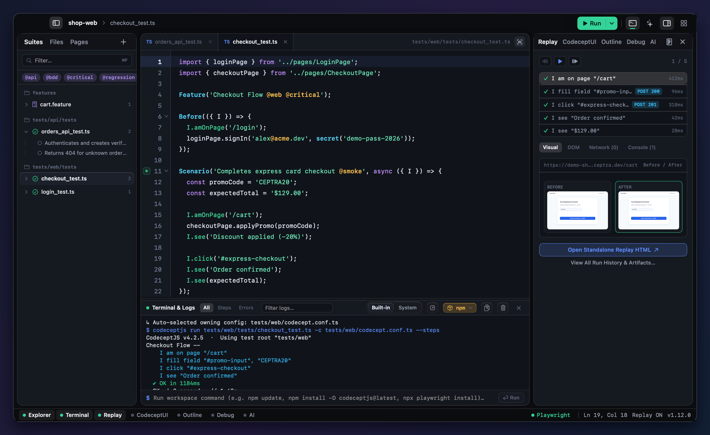

<p align="center">
  
</p>

<h1 align="center">Ceptra</h1>

<p align="center">
  <strong>Native macOS IDE for CodeceptJS 4.x &amp; Playwright Test.</strong><br/>
  Built in SwiftUI &amp; AppKit — zero Electron overhead, zero third-party Swift dependencies.
</p>

<p align="center">
  <a href="https://github.com/kobenguyent/Ceptra/releases/latest">
    
  </a>
  
  
  
  
  
  <a href="LICENSE">
    
  </a>
</p>

<p align="center">
  <a href="#why-ceptra">Why Ceptra</a> &nbsp;·&nbsp;
  <a href="#feature-highlights">Features</a> &nbsp;·&nbsp;
  <a href="#quick-start">Quick Start</a> &nbsp;·&nbsp;
  <a href="#documentation">Docs &amp; Guides</a> &nbsp;·&nbsp;
  <a href="docs/SHORTCUTS.md">Shortcuts</a>
</p>

<p align="center">
  
</p>

---

## Why Ceptra?

Running **CodeceptJS 4.x** or **Playwright Test (`@playwright/test`)** across TypeScript, ESM, browser projects, and REST/GraphQL suites usually means juggling an editor, terminal tabs, ad-hoc logs, and config flags. **Ceptra** brings both frameworks into one native macOS workspace:

| Challenge | How Ceptra Solves It |
| --- | --- |
| **Slow, memory-hungry editors** | Native **SwiftUI + AppKit** (`TextKit 1`) — fast startup, crisp typography, smooth pinch &amp; scroll zoom, zero Electron footprint. |
| **First-class Playwright Test &amp; CodeceptJS** | Auto-detects `playwright.config.{ts,js,mjs,cjs}` &amp; `codecept.conf.*`, parses `test.describe`/`test`/`test.step`/`page.*`/`expect` &amp; `Feature`/`Scenario`, embeds **Playwright UI Mode** (`playwright test --ui`) &amp; `@codeceptjs/ui`, plus **Playwright Codegen**, `--project` / `--workers` / `--headed` / `--trace` controls, and curated `page.*` / `expect().*` / `request.*` / `I.*` IntelliSense. |
| **Blind test failures** | **Zero-config Web &amp; API Time-Travel Replay** — automatic step screenshots, DOM snapshots, HTTP/fetch capture, Playwright step/attachment capture, JSON tree &amp; timing waterfall, exported as a single offline HTML file. |
| **Painful debugging** | **Built-in CDP Step-Through Debugger** (`⌘⇧B`) with gutter breakpoints, conditional breakpoints, logpoints, locals, watch expressions, `PWDEBUG=1` Inspector support, and CodeceptJS's interactive `pause()` shell. |
| **Monorepo config mistakes** | **Automatic per-file `-c` config resolution** — detects every `codecept.conf.*` and `playwright.config.*` even in mixed monorepos, picks the owning config &amp; framework toolchain automatically, and switches between **Node.js &amp; Bun** or **Built-in &amp; System Console** in one click. |
| **Authoring &amp; fixing tests** | **Multi-Provider AI Assistant &amp; `/commands`** (`⌘⌥A`) — framework-aware prompts for Playwright Test &amp; CodeceptJS with **Local Ollama**, Cloud APIs, or local CLI agents, multimodal attachments, portable `SKILL.md` skills, and 3-tier workspace permission controls. |
| **Sharing test snippets** | **Code Block Screenshots** (`⌘⌥P` / `⌘⌥⇧P`) — 1-step 2×/3× Retina PNG snapshots of any selection or enclosing `test()` / `Scenario()` block with gradients, themes, and macOS chrome. |

---

## Feature Highlights

### 1. Zero-Config Web &amp; API Time-Travel Replay
Run any Web or API test and scrub backward and forward through every step — directly in the embedded **Replay Inspector** (`⌘⌥T`) or in a **self-contained offline HTML report** ready for CI artifacts, Jira tickets, or Slack.

- **API Replay**: Automatically captures `REST`, `GraphQL`, `node:http`/`https`, `fetch`, `axios`, and `flex-rest` traffic (including `BeforeSuite` setup and `br`/`gzip` decompression) with secret header redaction, collapsible **JSON Tree** with click-to-copy JSONPath, **DNS/TCP/TLS/TTFB/Download timing waterfall**, assertion cards, structural JSON diff, one-click **Copy as `cURL` / `fetch()` / CodeceptJS**, and inline **Live Replay**.
- **Web Replay**: Captures **Before &amp; After screenshots** with curtain diff &amp; target selector reticles, **DOM snapshots**, correlated browser network requests, and console/page errors.

<p align="center">
  
</p>

<p align="center">
  
</p>

---

### 2. Interactive Step-Through CDP Debugger (`⌘⇧B`)
Debug CodeceptJS tests line-by-line in the editor with Chrome DevTools Protocol integration and source-mapped TypeScript support:

- Toggle breakpoints in the gutter or right-click to add **Conditional Breakpoints** and non-pausing **Logpoints**.
- Step with the floating **Debug Control Bar** — Continue (`⌃⌘Y`), Pause, Step Over (`⌘⇧'`), Step Into (`⌘⇧I`), Step Out (`⌘⇧O`).
- Inspect **Call Stack** (with *Just My Code* filtering), **Scopes &amp; Variables**, persistent **Watch Expressions**, live **Debug Eval**, and CodeceptJS's interactive `pause()` shell.

<p align="center">
  
</p>

---

### 3. Native AI Assistant, Universal `/commands` &amp; `SKILL.md` (`⌘⌥A`)
Write scenarios, harden flaky locators, and diagnose Replay traces using local models, cloud APIs, or local CLI tools:

- **Local Ollama, Cloud APIs &amp; CLI Agents**:
  - **Local Ollama**: Guided setup, 1-click local server start, and streaming model downloader — no API key required.
  - **Cloud APIs**: Anthropic Claude, OpenAI, Google Gemini, GitHub Models, and OpenAI-Compatible endpoints (LM Studio, vLLM, OpenRouter, Groq, DeepSeek).
  - **Local CLI Agents**: Reuses existing local logins for Claude Code (`claude`), OpenAI Codex (`codex`), Gemini CLI (`gemini`), and GitHub Copilot (`gh copilot`).
- **Universal `/commands` &amp; Portable `SKILL.md`**:
  - Built-in CodeceptJS 4.x commands work identically across Local Ollama, Cloud APIs, and CLI Agents: `/scenario`, `/fix`, `/page-object`, `/debug`, `/explain`, `/review`, `/api-test`, `/gherkin`, and `/skills`.
  - Discovers custom `SKILL.md` and command markdown files from `.ceptra/skills`, `.ceptra/commands`, `.agents/skills`, `.claude/skills`, `.codex/skills`, and `~/.ceptra/skills` (`Workspace > Built-in > Global`), with 1-click skill scaffolding.
- **Multimodal Attachments**: Paste (`⌘V`) or drag-and-drop screenshots, code/log files, PDFs, and `.mp4`/`.mov` test recordings alongside toggleable workspace context pills (`File`, `Selection`, `Console Errors`, `Replay Trace`, `I.* API`).
- **3-Tier Permissions &amp; Security**: Switch between **Read-Only** (`Read`), **Ask to Proceed** (`Ask`, unified diff preview before applying), and **Full Permissions** (`Full`, 1-click undoable Apply jailed to the open workspace). API keys stay in macOS Keychain; sensitive files (`.env`, private keys, `~/.ssh`, `~/.aws`, credentials) are blocked and automatically redacted before cloud requests.

<p align="center">
  
</p>

---

### 4. Code Block Screenshots (`⌘⌥P` / `⌘⌥⇧P`)
Turn any selected lines — or the enclosing `Scenario()`, `Feature`, function, or Gherkin block at your caret — into a **2× / 3× Retina PNG** inside the IDE:

- **1-Step Quick Copy (`⌘⌥⇧P`)** or right-click → **Quick Copy Screenshot** copies the PNG straight to your macOS clipboard (`⌘V` into Slack, GitHub, Notion, or Keynote).
- **Code Screenshot Studio (`⌘⌥P`)** includes **8 backdrops** (Candy, Midnight, Breeze, Sunset, Emerald, Amber, Graphite, and **Transparent**), **5 syntax themes** (Obsidian, Dracula, Catppuccin, Tokyo Night, Paper Light), auto-dedent with real line numbers, macOS window chrome, drag-and-drop export, and Save PNG (`⌘S`).

<p align="center">
  
</p>

<p align="center">
  
</p>

---

### 5. Adaptive Light &amp; Dark Themes · Multi-Config Monorepo Intelligence
Supports **Obsidian Dark**, **Paper Light**, and **Match macOS**:

- **Multi-Config Monorepo Support**: Automatically discovers every `codecept.conf.*` across nested packages (`tests/web/`, `tests/api/`, `configs/`), resolves the owning `-c` config per file on Run/Debug/Dry-Run, and auto-syncs the status bar helper (`Playwright` ↔ `REST`) and IntelliSense as you switch tabs.
- **Node.js &amp; Bun Runtime Switcher**: Toggle between Node.js (with zero-config ESM/CJS &amp; TypeScript worker compatibility) and Bun in one click.
- **Built-in Console or macOS System Console**: Stream tests inside Ceptra's drawer or launch natively in **Terminal.app**, **iTerm**, **Ghostty**, **Warp**, **Kitty**, **WezTerm**, or **Alacritty** (`⌘⇧T`).

<p align="center">
  
</p>

---

### 6. CodeceptJS 4.x Editor &amp; Runner Craft
- **Gutter Scenario Play Buttons**: Click any `Scenario()` in the gutter to run it immediately and see live pass/fail badges &amp; durations.
- **PyCharm-Style Symbol Navigation**: `⌘+Click` / `⌃+Click` / `F12` jumps across imports, `require()`, TypeScript path aliases, barrel re-exports, `include` Page Objects, custom `I.*` steps, Gherkin step definitions, and usages — with Back/Forward history (`⌃-` / `⌃⇧-`).
- **Smart IntelliSense &amp; Code Folding**: Auto-complete on `.`, `@`, `/` or `Ctrl+Space` for `I.*` actions, `steps.d.ts`, Page Objects, and `@tags`; non-destructive folding (`⌘⌥[` / `⌘⌥]`) for JS/TS/JSON/Gherkin/YAML/Markdown/XML.
- **Parallel Execution**: **`run-workers`** (`⌘⇧W` — `--by pool|test|suite`, `--serial`, `--last-failed`) and **`run-multiple`** (`⌘⇧M` — parsed `suite:browser` targets).
- **Embedded `@codeceptjs/ui` Live (`⌘⌥U`)**: Launch and inspect CodeceptUI on loopback (`127.0.0.1`) inside the right inspector.
- **Command Palette (`⌘K` / `⌘P`) &amp; Smooth Zoom**: Fuzzy-jump to any file, scenario, or action; pinch or `⌘+`/`⌘−`/`⌘0` to zoom smoothly with scroll anchoring.

---

## Quick Start

### Option 1: Download Prebuilt App
1. Download the latest `Ceptra-*-macOS-*.dmg` from [**GitHub Releases**](https://github.com/kobenguyent/Ceptra/releases/latest).
2. Drag **Ceptra.app** into `/Applications`.
3. If macOS Gatekeeper warns on first launch (ad-hoc signed build), run once in Terminal:
   ```bash
   xattr -cr /Applications/Ceptra.app
   ```
4. Launch **Ceptra**, press `⌘O`, and open any CodeceptJS 4.x project (or scaffold a starter workspace from the Welcome screen).

### Option 2: Build &amp; Install from Source
```bash
git clone https://github.com/kobenguyent/Ceptra.git
cd Ceptra
./scripts/install-local.sh
```

`install-local.sh` compiles a native Swift release binary, generates `Ceptra.icns`, assembles and ad-hoc signs `Ceptra.app`, clears quarantine attributes, installs to `/Applications/Ceptra.app`, and launches Ceptra.

- Install into your home directory without `sudo`:
  ```bash
  ./scripts/install-local.sh --install-dir "$HOME/Applications"
  ```
- Build distributable `.dmg`, `.zip`, and `SHA256SUMS.txt` locally:
  ```bash
  ./scripts/package-app.sh --version 1.12.0 --arch native
  # or universal (arm64 + x86_64):
  ./scripts/package-app.sh --version 1.12.0 --arch universal
  ```
- Run the test suite:
  ```bash
  swift test --parallel
  ```

---

## Documentation

| Guide | Contents |
| --- | --- |
| [**Features Guide**](docs/FEATURES.md) | Time-Travel Web &amp; API Replay, CDP Debugger, Native AI Assistant &amp; `/commands`, Code Block Screenshots, `@codeceptjs/ui` Live, and Editor Intelligence. |
| [**Monorepos, Runtimes &amp; Console**](docs/MONOREPO-AND-RUNTIMES.md) | Multi-config monorepo auto-resolution (`tests/web` + `tests/api`), Node.js vs Bun setup, TypeScript `tsx/esm`, System Console, and `run-workers`. |
| [**Keyboard Shortcuts**](docs/SHORTCUTS.md) | Categorized reference of every Ceptra shortcut. |

---

## Essential Shortcuts

| Shortcut | Action |
| --- | --- |
| `⌘K` / `⌘P` | Command Palette / Quick Open file or scenario |
| `⌘R` / `⌘⇧R` | Run all tests / Run current test file |
| `⌘⇧B` | Debug current test file (CDP breakpoints &amp; stepping) |
| `⌘⇧W` / `⌘⇧M` | Run parallel workers (`run-workers`) / Run multiple suites (`run-multiple`) |
| `⌘⌥A` | Toggle AI Assistant Inspector (`/commands` &amp; `SKILL.md`) |
| `⌘⌥P` / `⌘⌥⇧P` | Open Code Screenshot Studio / 1-Step Quick Copy Retina PNG |
| `⌘⌥T` / `⌘⌥U` / `⌘⌥O` | Toggle Replay Inspector / CodeceptUI Live / Flow Outline |
| `⌘+Click` / `F12` | Go to declaration, import target, `I.*` step, or usages |
| `⌘B` / `⌘J` / `⌘⌥B` | Toggle Explorer / Terminal Drawer / Right Inspector |

See all shortcuts in [**docs/SHORTCUTS.md**](docs/SHORTCUTS.md).

---

## Requirements

- **macOS 14.0 (Sonoma)** or later (Apple Silicon &amp; Intel)
- **Node.js** (or **Bun**) + **CodeceptJS 4.x** in your test workspace (or installed globally)
- **Swift 5.9+** (Xcode or Command Line Tools) only if building from source

---

## Automatic Releases &amp; In-App Auto-Updater

- **CI (`.github/workflows/ci.yml`)**: Runs `swift test --parallel`, release builds, `.app`/`.dmg`/`.zip` packaging, and `SHA256SUMS.txt` verification on `macos-15`.
- **Automatic Release (`.github/workflows/release.yml`)**: Computes SemVer bumps via `scripts/next-version.sh`, builds universal (`arm64` + `x86_64`) archives, signs checksums, tags, and publishes GitHub Releases automatically on push to `main` (add `[skip release]` to skip).
- **In-App Updater**: **Ceptra → Check for Updates…** downloads the latest GitHub Release, verifies `SHA256SUMS.txt` via `CryptoKit`, and atomically updates &amp; relaunches `Ceptra.app` with rollback protection.

---

## License

Released under the [MIT License](LICENSE).
