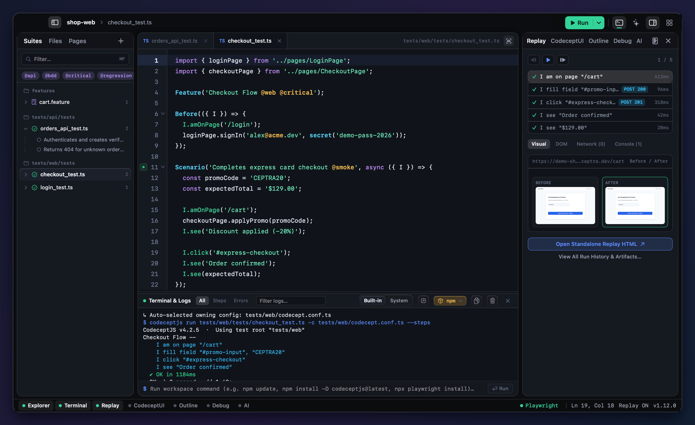
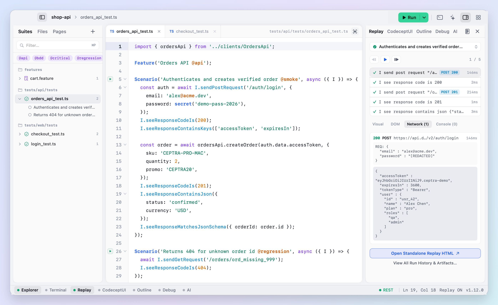
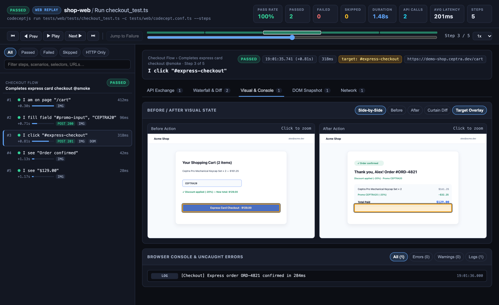
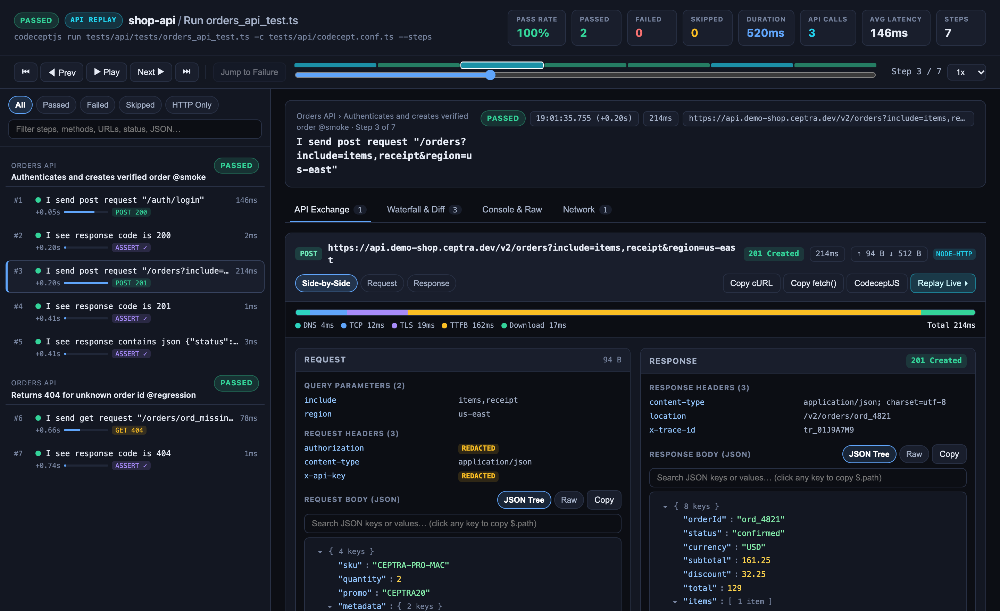
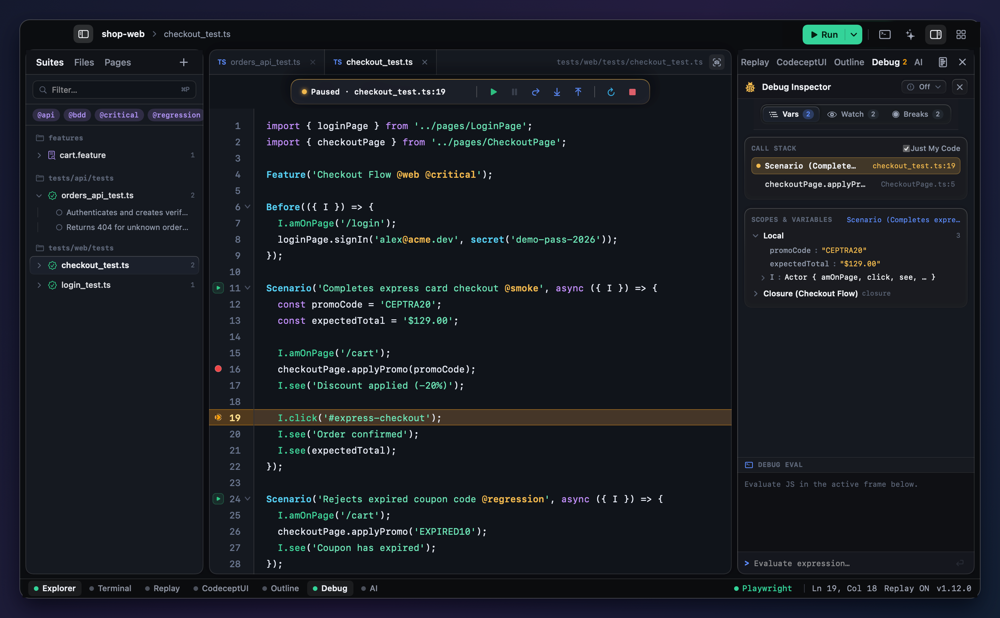
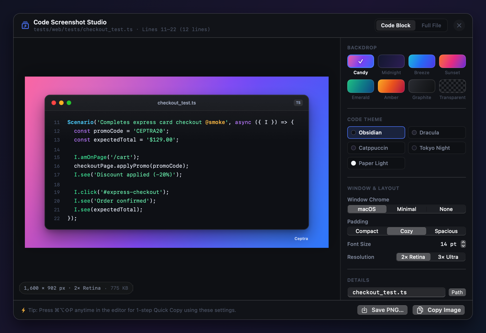
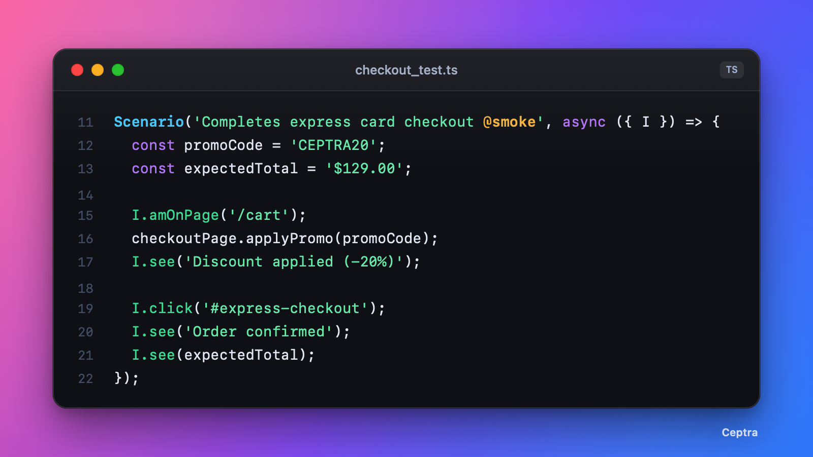
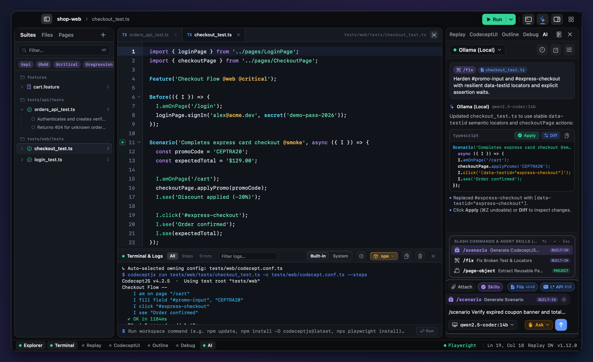

# Ceptra Features Guide

A tour of everything built into **Ceptra** — the native macOS IDE crafted specifically for **CodeceptJS 4.x**.

---

## 1. Soft 3-Pane Native macOS Studio

Ceptra is built from the ground up in **SwiftUI + AppKit** (macOS 14+, zero Electron, zero third-party Swift packages).

- **Left Pane — Smart Workspace Explorer (`⌘B`)**: Hierarchical project tree with CodeceptJS-aware classification (Test Suites, Gherkin `.feature` files, Page/Step Objects, Helpers, Configs), recursive scenario counts, `@tag` filtering, inline Run/Scenario actions, and file/folder creation at any level (`⌘N` / `⌘⇧N`).
- **Center Pane — Native Code Editor & Terminal Drawer (`⌘J`)**: Explicit TextKit 1 `NSTextView` with per-tab scroll, cursor, fold, and undo isolation, drag-to-reorder tabs, and a resizable streaming console drawer with package scripts (`npm`/`pnpm`/`yarn`/`bun`) and custom shell input (`⌘⇧K`).
- **Right Pane — Single-Slot Inspector (`⌘⌥B`)**: Switch cleanly between **Replay** (`⌘⌥T`), **CodeceptUI Live** (`⌘⌥U`), **Flow Outline** (`⌘⌥O`), **Debug & Breakpoints** (`⌘⌥J`), and **AI Assistant** (`⌘⌥A`).
- **Adaptive Themes**: Switch between **Obsidian Dark**, **Paper Light**, or **Match macOS** in Settings (`⌘,`) or via the Command Palette (`⌘K`).

  

  

---

## 2. Interactive Web & API Time-Travel Replay

Every test run can automatically capture step-by-step diagnostics via Ceptra's zero-config recorder plugin — **without editing your `codecept.conf.*`**.

### Web Replay (Playwright, Puppeteer, WebDriver, CDPBrowser)
- **Visual Step Timeline**: Scrub through every `I.*` action with play/pause controls and keyboard navigation, plus instant jump-to-failure.
- **Before & After Screenshots**: Side-by-side / curtain diff visual comparison with target selector highlight reticle.
- **DOM Snapshot Inspector**: Inspect captured HTML structure, source, and matched target element (`data-ceptra-target`) per step.
- **Browser Network & Console**: Correlates XHR/fetch traffic, response codes, latency, console logs, and uncaught page errors to the exact step that triggered them.

  

### API Replay (REST, GraphQL, `fetch`, `axios`, `flex-rest`, `node:http`/`https`)
- **Universal Zero-Config Capture**: Intercepts `node:http`/`node:https` and `globalThis.fetch` automatically (including direct `axios` / `flex-rest` calls outside `I.*` and `BeforeSuite` setup traffic), decompressing `br` (Brotli), `gzip`, and `deflate` responses cleanly.
- **Automatic Secret Redaction**: Redacts sensitive headers (`authorization`, `cookie`, `set-cookie`, `x-api-key`, `x-auth-token`, `proxy-authorization`) before saving traces or HTML.
- **Interactive API Exchange Inspector**:
  - Request / Response split pane with parsed Query Parameters and headers.
  - Collapsible **JSON Tree** with instant search and **click-to-copy JSONPath**.
  - **Timing Breakdown** bar (`DNS` · `TCP` · `TLS` · `TTFB` · `Download`).
  - Linked **Assertion Cards** (`I.seeResponseCodeIs`, `I.seeResponseContainsJson`, `expect`, etc.).
  - One-click **Copy as `cURL`**, **`fetch()`**, or **CodeceptJS** snippet, plus **Waterfall & Structural JSON Diff** between any two responses and inline **Live Replay**.
- **Self-Contained Offline HTML**: Every run exports a single standalone `ceptra-time-travel-report.html` you can attach to CI artifacts, Jira tickets, or Slack threads with zero external server required.

  

---

## 3. Interactive Step-Through CDP Debugger

Debug CodeceptJS tests visually with full Chrome DevTools Protocol (CDP) integration over Node.js (`⌘⇧B`):

- **Gutter Breakpoints**: Click the editor gutter to toggle line breakpoints; right-click any gutter line to add **Conditional Breakpoints** (e.g. `promoCode === 'CEPTRA20'`) or non-pausing **Logpoints** (`user={user.id}`).
- **Source-Mapped TypeScript Stepping**: Step cleanly across `.ts` test files and Page Objects via inline V3 source maps.
- **Floating Debug Control Bar**: Continue (`⌃⌘Y`), Pause, Step Over (`⌘⇧'`), Step Into (`⌘⇧I`), Step Out (`⌘⇧O`), Restart, and Stop (`⌘.`).
- **Live Inspection**: Inspect the **Call Stack** (with Just My Code filtering), **Scopes & Locals**, persistent **Watch Expressions**, an interactive **Debug Console** evaluator, and CodeceptJS's built-in interactive `pause()` shell directly in the terminal drawer.

  

---

## 4. Quick Beautiful Code Block Screenshots

Share crisp, Ray.so-style code snippets in PR descriptions, bug reports, docs, slides, or social posts without leaving your editor:

- **1-Step Instant Quick Copy (`⌘⌥⇧P`)**: Renders a 2×/3× Retina PNG of your selected lines — or automatically detects the enclosing `Scenario(...)`, `Feature`, function, or Gherkin block (including `@tags`) at your caret — and puts it straight on your clipboard (`⌘V` anywhere).
- **Code Screenshot Studio (`⌘⌥P`)**: Live interactive customizer with:
  - **8 Curated Backdrops**: Candy, Midnight, Breeze, Sunset, Emerald, Amber, Graphite, and **Transparent** (floating rounded macOS card with transparent alpha).
  - **5 Syntax Themes**: Obsidian, Dracula, Catppuccin, Tokyo Night, and Paper Light.
  - **Smart Details**: Auto-dedented indentation preserving real source line numbers, macOS traffic lights / Minimal / Frameless chrome, editable filename title + language pill, `2×` / `3×` resolution, drag-and-drop export, and Save PNG (`⌘S`).
  - Your chosen style persists automatically so `⌘⌥⇧P` Quick Copy always matches your favorite look.

  

  

---

## 5. CodeceptJS-Native Editor Intelligence

- **Gutter Play Buttons & Live Status**: Every `Scenario()` gets an inline gutter play trigger and live pass/fail badge with execution duration.
- **PyCharm-Style Symbol Navigation**: `⌘+Click`, `⌃+Click`, `F12`, or `⌃B` resolves imports, `require()`, TypeScript path aliases, barrel re-exports, `codecept.conf.*` `include` objects, custom `I.*` steps, Gherkin step definitions, and usages across the workspace — with Back/Forward history (`⌃-` / `⌃⇧-`).
- **IntelliSense Auto-Complete**: Triggers automatically on `.`, `@`, `/`, or via `Ctrl+Space` for `I.*` helper actions, `steps.d.ts`, Page Objects, `@tags`, and relative import paths.
- **Non-Destructive Code Folding**: Collapse/expand braces, arrays, comments, imports, Gherkin sections, YAML, Markdown, and XML via gutter chevrons, inline `⋯ N lines` badges, or shortcuts (`⌘⌥[` / `⌘⌥]`).
- **Smooth Scroll-Anchored Zoom**: Zoom smoothly with `⌘+` / `⌘−` / `⌘0`, trackpad pinch, or `⌘ + scroll wheel` with a floating percentage HUD.
- **Command Palette (`⌘K` / `⌘P`)**: Fuzzy-jump to any file, `Scenario`, or studio command in milliseconds.

---

## 6. Embedded `@codeceptjs/ui` Live & Reports Dashboard

- **CodeceptUI Live (`⌘⌥U`)**: Automatically detects `@codeceptjs/ui` in your project (or installs it with one click), binds strictly to loopback (`127.0.0.1`), and embeds the live CodeceptUI dashboard inside the right inspector.
- **Reports & Artifacts Dashboard**: Stores per-project run history with pass-rate trend bars, parses CodeceptJS 4.x `junitReporter` XML, previews `output/` screenshots, `aiTrace` markdown files, screencasts, and exports reports to Markdown or standalone HTML.

---

## 7. Native AI Assistant, Universal `/commands` & `SKILL.md` (`⌘⌥A`)

Ceptra includes a built-in AI Assistant designed for CodeceptJS 4.x authoring, locator hardening, and failure diagnosis:

- **Local Ollama, Cloud APIs & CLI Agents**:
  - **Local Ollama**: Guided 1-click install, local server start, and streaming model pulls without API keys.
  - **Cloud APIs**: Anthropic Claude, OpenAI, Google Gemini, GitHub Models, and OpenAI-Compatible endpoints (LM Studio, vLLM, OpenRouter, Groq, DeepSeek).
  - **Local CLI Agents**: Uses existing local CLI sessions for Claude Code (`claude`), OpenAI Codex (`codex`), Gemini CLI (`gemini`), and GitHub Copilot (`gh copilot`).
- **Universal `/commands` & Portable `SKILL.md`**:
  - 9 built-in CodeceptJS commands work identically across Local Ollama, Cloud APIs, and CLI Agents: `/scenario`, `/fix`, `/page-object`, `/debug`, `/explain`, `/review`, `/api-test`, `/gherkin`, and `/skills`.
  - Discovers custom `SKILL.md` and command markdown files from `.ceptra/skills`, `.ceptra/commands`, `.agents/skills`, `.claude/skills`, `.codex/skills`, and `~/.ceptra/skills` (`Workspace > Built-in > Global`), with 1-click skill scaffolding.
- **Multimodal Context**: Paste (`⌘V`) or drag-and-drop screenshots, code/log files, PDFs, and `.mp4`/`.mov` test videos alongside toggleable workspace context pills (`File`, `Selection`, `Console Errors`, `Replay Trace`, `I.* API`).
- **3-Tier Permission Modes & Host Isolation**:
  - Switch between **Read-Only** (`Read`), **Ask to Proceed** (`Ask`, unified diff preview before applying), and **Full Permissions** (`Full`, 1-click undoable Apply scoped strictly to the open workspace).
  - API keys are stored exclusively in macOS Keychain; sensitive files (`.env`, private keys, `~/.ssh`, `~/.aws`, credentials) are blocked from attachment and scrubbed via automatic secret redaction.

  

---

## 8. Multi-Config Monorepos, Node/Bun & System Console

See the dedicated [Monorepo & Runtimes Guide](MONOREPO-AND-RUNTIMES.md) for full details on:
- Automatic per-file `-c` config resolution across monorepo suites (`tests/api/` + `tests/web/`).
- 1-click **Node.js vs Bun** runtime switching.
- **Built-in Console vs macOS System Console** (Terminal.app, iTerm2, Ghostty, Warp, Kitty, WezTerm, Alacritty).
- Parallel execution via `run-workers` (`⌘⇧W`) and `run-multiple` (`⌘⇧M`).
- Zero-config ESM/CJS & TypeScript worker compatibility (`module.registerHooks`).
