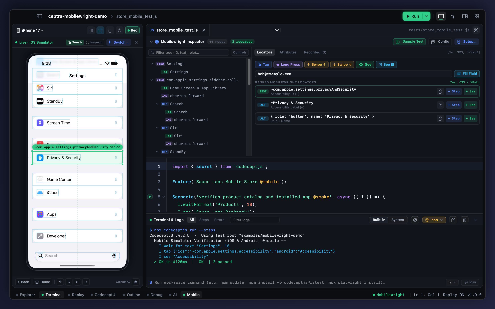
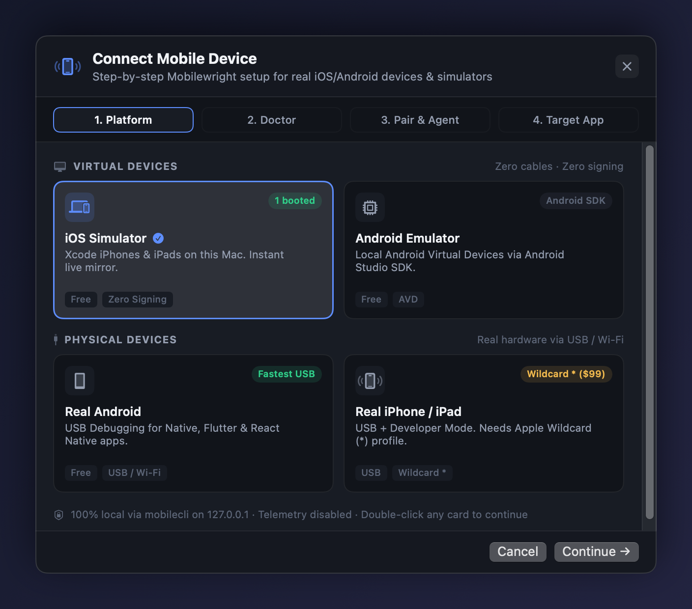

# Mobilewright Device Studio (iOS & Android)

Test native **iOS** and **Android** apps with [`@codeceptjs/mobilewright`](https://mobilewright.dev) directly inside Ceptra — **without installing or running an Appium server**.

Toggle **Mobilewright Device Studio** anytime via **Mobile** in the bottom dock or ++cmd+option+m++.

{ .ceptra-shot }

---

## Guided 4-Step Connect Device Wizard

Click **Connect Mobile Device…** (from the Tools popover or View menu) to launch the guided setup wizard:

{ .ceptra-shot }

1. **Choose Device Category**:
   - **Virtual Devices**: **iOS Simulator** (free, zero code signing required) and **Android Emulator**.
   - **Physical Devices**: **Real Android USB** (via ADB) and **Real iPhone / iPad** (with automatic `.mobileprovision` wildcard provisioning profile detection & validation).
2. **Doctor & Prerequisites**: Runs `mobilewright doctor` inline with 1-click installs for missing tooling.
3. **Select & Boot Target**: Searchable `iPhone` / `iPad` / `All` simulator filters and live plugged-in USB device detection.
4. **Launch & Mirror**: Connects straight into the docked Phone Mirror sidebar (dockable on Left or Right).

---

## Live Phone Mirror & Interaction Modes

- **Fast Framebuffer Capture**: Uses native `xcrun simctl io` framebuffer capture on iOS Simulators and ADB capture on Android with 2-stage post-action settle refresh and idle auto-stream that automatically re-syncs the UI tree when screen content changes.
- **Touch & Swipe Mode**: Click directly on the mirrored phone screen to tap, drag to swipe (with a live directional vector arrow), or use the 1-click directional swipe pad (`↑ ↓ ← →`) and iOS edge back-swipe.
- **Inspect & Wireframe Mode**:
  - Calibrates exact hardware viewports (`mobilecli device info` + pixel fallback) so floating iOS permission alerts, sheets, and modals align pixel-accurately.
  - Toggle **Wireframe Bounds** to visualize every element rectangle on screen.
  - Click any element to inspect its accessibility attributes and **ranked zero-CSS/XPath Mobilewright locators** (`~accessibilityId`, `#resourceId`, `{ role, name }`).

---

## Live Step Recording & Sample Test Generator

- **Record to Editor**: Enable **Rec** to append verified Mobilewright steps (`I.tap(...)`, `I.fillField(...)`, `I.swipe(...)`) straight into your active test file, with automatic `secret(...)` masking on password fields.
- **Mobile Time-Travel Replay**: Mobilewright runs capture device screenshots, view trees, and target element bounds directly into Ceptra's Replay Inspector and offline Replay HTML reports.
- **Zero-Device Demo**: Try Mobilewright right away with the bundled demo workspace in [`examples/mobilewright-demo/`](https://github.com/kobenguyent/Ceptra/tree/main/examples/mobilewright-demo):

```bash
cd examples/mobilewright-demo
npm install
npx codeceptjs run --steps
```
