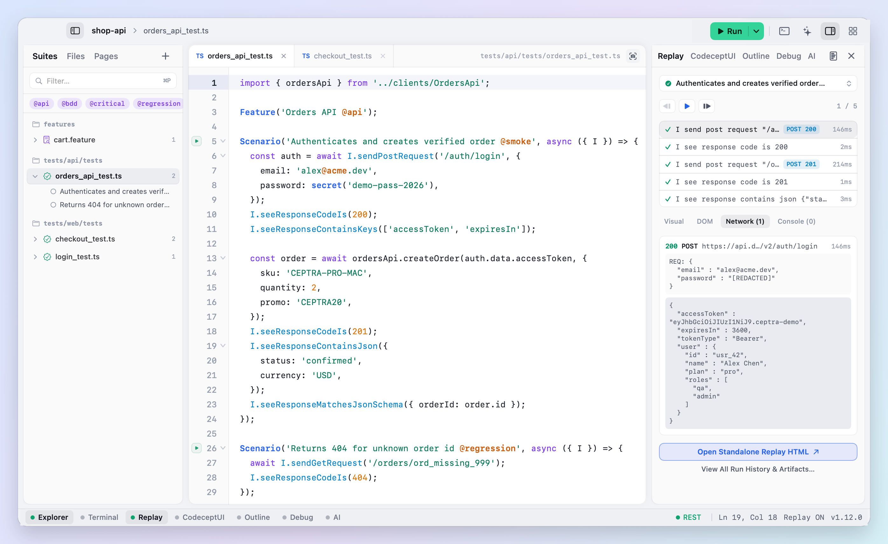

# 5-Minute Quick Start

Get from first launch to running tests, inspecting Time-Travel Replays, and testing API collections in five minutes.

---

## 1. Open or Scaffold a Workspace

When you launch Ceptra, you can either open an existing project (++cmd+o++) or scaffold a ready-to-run starter workspace from the **Welcome Screen**, **File → Create Sample Workspace**, the top-bar Workspace menu, or the **Command Palette** (++cmd+k++):

=== "Playwright Test (TypeScript)"

    1. Choose **Create Sample Playwright Test Workspace…** and pick a folder.
    2. Open the bottom Terminal drawer (++cmd+j++) and run the pre-suggested dependency install (`npm install` &amp; `npx playwright install`).
    3. Click any green gutter **Play** button next to `test(...)` in `tests/example.spec.ts` or `tests/api.spec.ts`.

=== "Playwright Python (pytest)"

    1. Choose **Create Sample Playwright Python Workspace…** and pick a folder.
    2. Click **Install Dependencies** in the Terminal drawer — Ceptra automatically bootstraps `.venv`, installs `requirements.txt`, and sets `pythonpath = .`.
    3. Click the gutter **Play** button next to `def test_has_title_and_opens_getting_started` or `def test_fetches_todo_resource`.

=== "CodeceptJS 4.x"

    1. Choose **Create Sample CodeceptJS 4.x Workspace…** and pick a folder.
    2. Run `npm install` from the Terminal drawer (++cmd+j++).
    3. Click any gutter **Play** button next to `Scenario(...)` to execute with live status badges and Time-Travel Replay.

---

## 2. Inspect Time-Travel Replay

By default, Ceptra captures step-by-step telemetry automatically without editing your config files:

1. Press ++cmd+r++ to run the suite (or ++cmd+shift+r++ for the active file).
2. The **Replay Inspector** (++cmd+option+t++) opens in the right pane showing every executed step, duration, screenshot, DOM snapshot, and HTTP exchange.
3. Click **Export Replay HTML** to save a single standalone offline HTML report you can share in Slack, Jira, or CI artifacts.

{ .ceptra-shot }

---

## 3. Try the Built-in API Client Studio (No Postman Needed)

You can test REST and GraphQL APIs immediately — even before opening a test repository:

1. Click **`API`** in the bottom module dock (or press ++cmd+option+i++).
2. Click **Load All 3 Examples** on the API Studio welcome screen (or choose **Import → Load Example Collection**) to load live runnable collections for **JSONPlaceholder (REST CRUD &amp; Chaining)**, **HTTPBin (Auth, Forms &amp; Cookies)**, and **Countries GraphQL**.
3. Select **Get Todo by ID** and press ++cmd+return++ to send the request and inspect the pretty JSON body, headers, timing breakdown, and assertions.
4. Click **Run Collection** in the toolbar to run the whole collection sequentially with automatic variable chaining (`$.userId` → `{{lastUserId}}`), then click **Open in Replay** or **Export Replay HTML…**.
5. Want to test importing Postman/Insomnia/OpenAPI files? Click **Import → Generate Sample Import Files…** to scaffold ready-to-import files in your workspace.

---

## 4. Explore Other Studio Modules

Use the slim 28pt **Bottom Module Dock** or keyboard shortcuts to toggle any module without cluttering the header:

| Module | Shortcut | Purpose |
| --- | --- | --- |
| **Explorer** | ++cmd+b++ | Suites, Files, and Page Objects tree |
| **Terminal** | ++cmd+j++ | Streaming logs, runtime-adapted quick commands &amp; `pause()` shell |
| **Replay** | ++cmd+option+t++ | Interactive Web, API &amp; Mobile step-by-step player |
| **UI Live** | ++cmd+option+u++ | Embedded `@codeceptjs/ui` or Playwright UI Mode |
| **Debug** | ++cmd+shift+b++ | Interactive CDP step-through debugger |
| **AI Assistant** | ++cmd+option+a++ | Local Ollama, Cloud APIs, CLI agents &amp; universal `/commands` |
| **Mobile Studio** | ++cmd+option+m++ | Live iOS Simulator &amp; Android device mirror + inspector |
| **API Studio** | ++cmd+option+i++ | Postman / Insomnia / OpenAPI / HAR / `.http` / cURL client |
