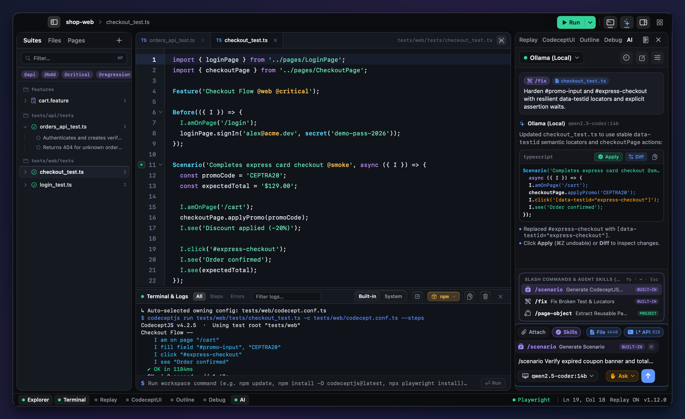

# Native AI Assistant, Universal `/commands` & `SKILL.md`

Ceptra's built-in **AI Assistant** (++cmd+option+a++) helps you author test scenarios, refactor Page Objects, harden flaky locators, and diagnose failing Time-Travel Replay traces — using local models, cloud APIs, or your existing local CLI agent logins.

{ .ceptra-shot }

---

## Supported Providers

| Category | Providers | Notes |
| --- | --- | --- |
| **Local Ollama** | Any Ollama model (e.g., `qwen2.5-coder`, `llama3.2`, `deepseek-r1`) | Guided setup, 1-click local server start, streaming model pulls — **zero API keys required** |
| **Cloud APIs** | Anthropic Claude, OpenAI, Google Gemini, GitHub Models, OpenAI-Compatible (LM Studio, vLLM, OpenRouter, Groq, DeepSeek) | API keys stored strictly in **macOS Keychain** — never written to JSON settings |
| **Local CLI Agents** | Claude Code (`claude`), OpenAI Codex (`codex`), Gemini CLI (`gemini`), GitHub Copilot (`gh copilot`) | Reuses your existing local CLI sessions in an isolated sandboxed subprocess environment |

---

## Universal `/commands` & Portable `SKILL.md`

Ceptra includes **9 built-in slash commands** that work identically across Local Ollama, Cloud APIs, and CLI Agents — automatically adapting prompts to **CodeceptJS 4.x**, **Playwright TS/JS**, **Playwright Python**, or **Mobilewright**:

| Command | Purpose |
| --- | --- |
| `/scenario` | Generate a complete test scenario matching active workspace conventions &amp; Page Objects |
| `/fix` | Diagnose &amp; fix failing tests or flaky locators using Console errors &amp; Replay trace |
| `/page-object` | Extract or scaffold a clean Page Object / helper class |
| `/debug` | Analyze a failing step's DOM, network response, and stack trace |
| `/explain` | Explain complex helper, fixture, or test flows concisely |
| `/review` | Review tests for flakiness, anti-patterns, and missing assertions |
| `/api-test` | Generate REST/GraphQL API tests (CodeceptJS, Playwright TS, or Python) |
| `/gherkin` | Author or convert BDD Gherkin `.feature` files and step definitions |
| `/skills` | List and inspect all discovered built-in, global, and workspace skills |

### Authoring Custom `SKILL.md` Files

Drop portable `SKILL.md` or command markdown files in any of these locations (highest priority wins: **Workspace > Built-in > Global**):

- Workspace: `.ceptra/skills/`, `.ceptra/commands/`, `.agents/skills/`, `.claude/skills/`, `.codex/skills/`
- Global: `~/.ceptra/skills/`

You can also scaffold a valid `SKILL.md` template in one click from the AI Assistant's Skills manager.

---

## Multimodal Context & Workspace Pills

Attach rich context alongside any prompt:

- **Context Pills**: Toggle `File`, `Selection`, `Console Errors`, `Replay Trace` (including pinning a specific failing Replay step), and framework API (`I.* API` / Playwright / Mobilewright).
- **Multimodal Attachments**: Paste (++cmd+v++) or drag-and-drop screenshots, log/code files, PDFs (page-1 snapshot rendered natively), and `.mp4`/`.mov` test recordings.

---

## 3-Tier Workspace Permission Model & Security Firewall

Choose the exact autonomy level you want in the AI panel header:

1. **Read-Only (`Read`)**: Answers, analysis, and code suggestions only — zero file edits permitted.
2. **Ask to Proceed (`Ask`, default)**: Shows a full **Unified Diff Preview** sheet before modifying any workspace file.
3. **Full Permissions (`Full`)**: Enables 1-click undoable Apply jailed strictly inside the open workspace root.

!!! warning "Automatic Secret Redaction & Sensitive File Firewall"
    Ceptra automatically blocks attaching `.env` files, private keys, `~/.ssh`, `~/.aws`, and symlink escapes outside the workspace — and scrubs bearer tokens, provider API keys, cookies, passwords, and database connection URIs before sending context to any cloud provider.
