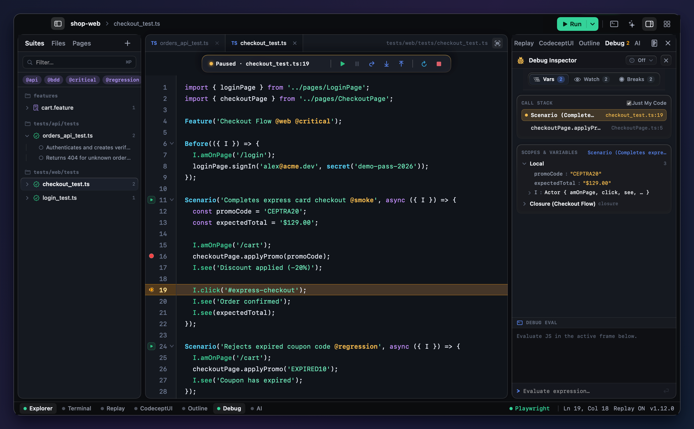

# Interactive CDP Step-Through Debugger

Debug tests visually line-by-line right inside Ceptra using native Chrome DevTools Protocol (CDP) integration over Node.js (++cmd+shift+b++).

{ .ceptra-shot }

---

## Breakpoints, Conditions & Logpoints

- **Line Breakpoints**: Click any line number in the editor gutter to toggle a red breakpoint dot. Breakpoints persist per workspace automatically.
- **Conditional Breakpoints**: Right-click a gutter line to attach a JavaScript expression (for example, `promoCode === 'CEPTRA20'` or `items.length > 3`) so execution only pauses when the condition evaluates to truthy.
- **Non-Pausing Logpoints**: Right-click a gutter line and add a log message with `{expression}` interpolation (for example, `Order created: {order.id}`) to stream live values into the debug console without interrupting test execution.
- **Source-Mapped TypeScript Stepping**: Step cleanly across `.ts` test suites and Page Objects via inline V3 source maps.

---

## Floating Debug Control Bar

When a debug session starts, a centered floating control bar appears above the editor:

| Control | Shortcut | Action |
| --- | --- | --- |
| **Continue** | ++ctrl+cmd+y++ | Resume execution until the next breakpoint |
| **Pause** | — | Pause running JavaScript execution |
| **Step Over** | ++cmd+shift+apostrophe++ | Execute current line without entering function calls |
| **Step Into** | ++cmd+shift+i++ | Step into the called helper or Page Object method |
| **Step Out** | ++cmd+shift+o++ | Run until returning from the current function |
| **Stop** | ++cmd+period++ | Terminate the active debug session |

---

## Inspecting Live State

Open the **Debug &amp; Breakpoints Inspector** (++cmd+option+j++) in the right pane to inspect:

- **Call Stack**: Click any stack frame to jump straight to that line, with **Just My Code** filtering to hide noisy framework internals.
- **Scopes &amp; Local Variables**: Expand objects, arrays, and closures at the paused frame.
- **Watch Expressions**: Pin persistent expressions evaluated automatically on every step.
- **Debug Eval Console**: Evaluate arbitrary expressions against the active paused call frame.
- **Interactive `pause()` &amp; `PWDEBUG=1`**: CodeceptJS's interactive `pause()` shell works directly in Ceptra's Terminal drawer, and Playwright suites support `PWDEBUG=1` Inspector sessions via Run Options.
