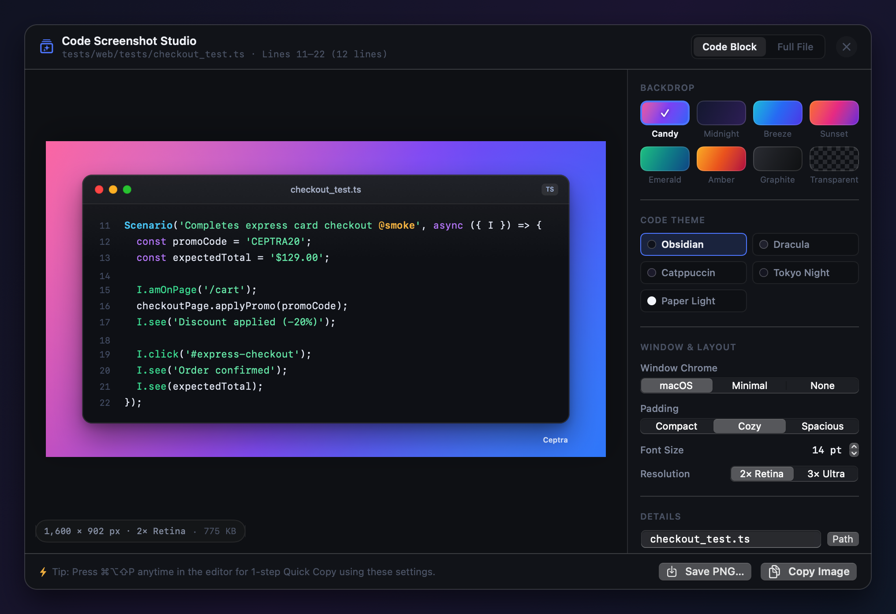
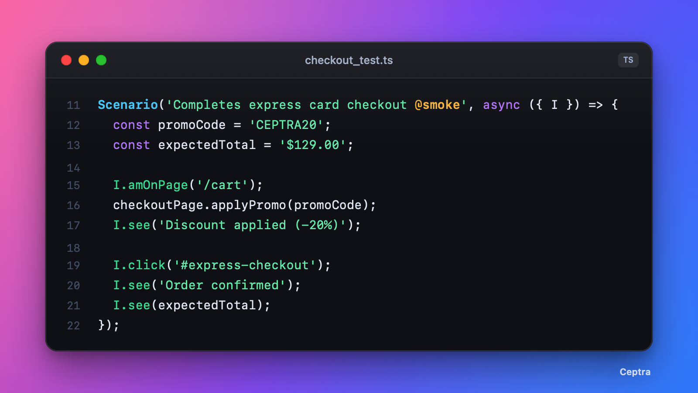

# Editor Craft, Many-Files Tab Management & Code Screenshots

Ceptra's editor is built directly on Apple's **AppKit `NSTextView` (TextKit 1)** for instant startup, smooth 120Hz scrolling, and zero Electron memory bloat.

---

## Managing Many Open Files

- **Drag-to-Reorder Tabs**: Smooth, oscillation-free drag reordering across variable-width tabs with live sibling displacement and subtle haptic alignment ticks.
- **Per-Tab &amp; Empty-Rail Context Menus**: Right-click any tab to:
  - **Close** (++cmd+w++), **Close Others** (++cmd+option+w++), **Close Tabs to the Right**, **Close Tabs to the Left**, **Close Saved Tabs** (keeps unsaved edits untouched), **Close All Tabs**, and **Reopen Closed Tab**
  - **Save** / **Save All**, **Run Test File** / **Debug Test File** (for executable suites)
  - **Copy Relative Path**, **Copy Full Path**, **Reveal in Explorer**, and **Reveal in Finder**
- **Anchored Open Tabs Switcher**: When multiple files are open, a compact tab-count switcher pill (`N ⌄`) stays pinned at the trailing edge of the tab rail so you can jump straight to any open tab (with checkmark, dirty indicator `●`, and bulk close actions) even with dozens of files open.
- **Automatic Duplicate-Filename Disambiguation**: Opening files that share a filename (for example, `tests/web/login_test.ts` and `tests/api/login_test.ts`) automatically shows minimal parent-folder hints (`web`, `api`) in both the tab bar and switcher.

---

## Navigation, IntelliSense, Folding & Zoom

- **PyCharm-Style Symbol Navigation**: ++cmd++ + Click, ++ctrl++ + Click, or ++f12++ jumps to imports, `require()`, TypeScript path aliases, barrel re-exports, `codecept.conf.*` `include` Page Objects, custom `I.*` steps, Gherkin step definitions, and workspace usages — with **Back / Forward** history (++ctrl+minus++ / ++ctrl+shift+minus++).
- **Framework-Aware IntelliSense**: Auto-completes on `.`, `@`, `/`, or ++ctrl+space++ for CodeceptJS `I.*` &amp; `steps.d.ts`, Playwright TS callback arguments (`async ({ page, request })`), Playwright Python fixtures &amp; `snake_case` APIs (`page.get_by_role`, `expect(page).to_have_title`), Page Objects, `@tags`, and relative paths.
- **Non-Destructive Code Folding**: Collapse or expand blocks via gutter chevrons, inline `⋯ N lines` badges, or shortcuts (++cmd+option+bracket-left++ / ++cmd+option+bracket-right++ and ++cmd+option+shift+bracket-left++ / ++cmd+option+shift+bracket-right++) across JS, TS, Python, JSON, Gherkin, YAML, Markdown, and XML.
- **Smooth Scroll-Anchored Zoom**: Zoom smoothly with ++cmd+equal++ / ++cmd+minus++ / ++cmd+0++, trackpad pinch, or ++cmd++ + scroll wheel with a subtle floating percentage HUD.
- **Command Palette (++cmd+k++ / ++cmd+p++)**: Fuzzy-jump to any file, scenario, tab action, or studio tool in milliseconds.

---

## Code Block Screenshots (`⌘⌥P` / `⌘⌥⇧P`)

Capture crisp, publication-ready **2× / 3× Retina PNG** screenshots of any code block right inside Ceptra:

- **1-Step Quick Copy (++cmd+option+shift+p++)**: Automatically extracts your current selection — or smartly detects the enclosing `Scenario()`, `test()`, Python `def test_*` (including `@pytest.mark.*` decorators), or Gherkin block at your caret — and puts the Retina PNG straight onto your clipboard (`⌘V` into Slack, GitHub PRs, Jira, Notion, or slides).
- **Code Screenshot Studio (++cmd+option+p++)**: Interactive preview with:
  - **8 Curated Backdrops**: Candy, Midnight, Breeze, Sunset, Emerald, Amber, Graphite, and **Transparent**
  - **5 Syntax Themes**: Obsidian, Dracula, Catppuccin, Tokyo Night, and Paper Light
  - Auto-dedented indentation preserving original line numbers, macOS traffic-light / minimal / frameless window chrome, drag-and-drop export, and Save PNG (++cmd+s++).

{ .ceptra-shot }

{ .ceptra-shot }
