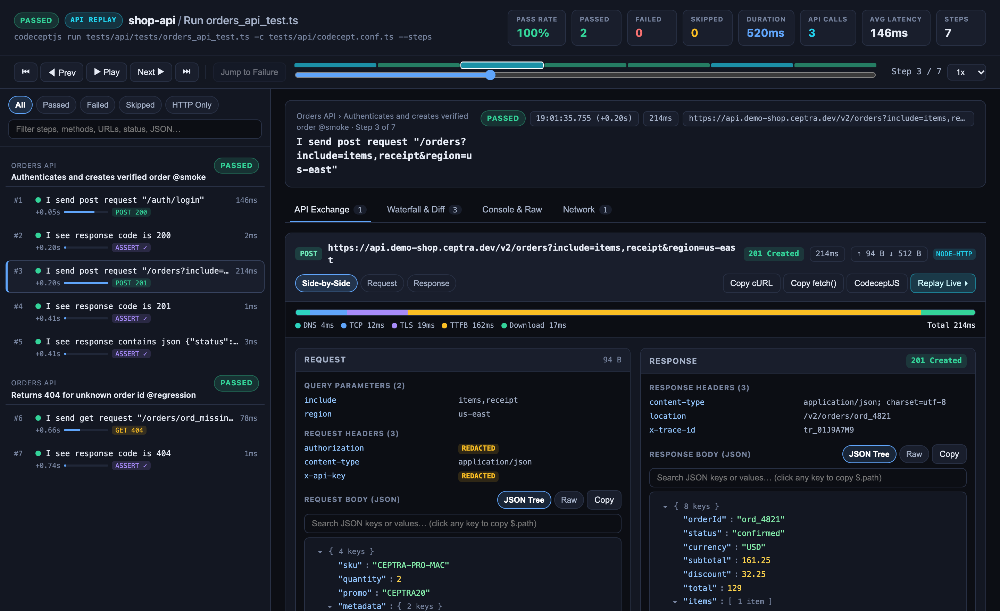
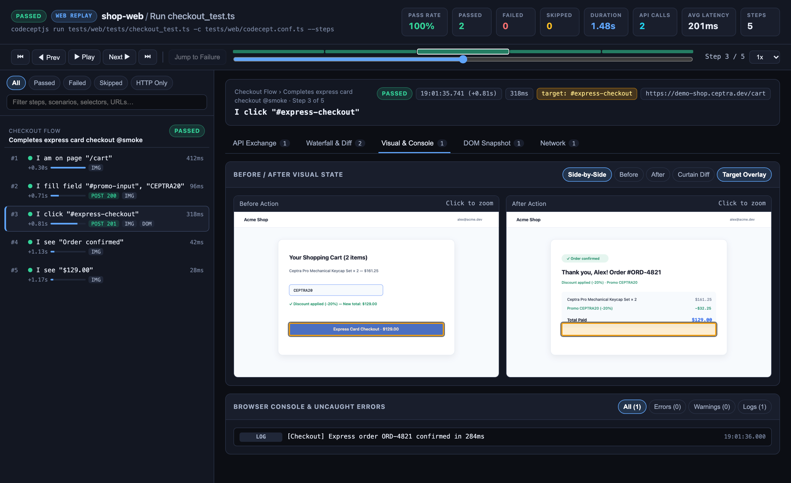

# Time-Travel Replay (Web, API, Hybrid & Mobile)

Every test run in Ceptra — across **CodeceptJS**, **Playwright (TS/JS & Python)**, **Mobilewright**, and **API Client Studio Collection Runs** — can capture rich step-by-step diagnostics automatically with **zero edits to your project configs**.

Toggle the embedded **Replay Inspector** anytime with ++cmd+option+t++ or export a **100% self-contained offline HTML report** (`ceptra-time-travel-report.html`) to attach to CI artifacts, Jira issues, or Slack threads.

---

## API Replay

{ .ceptra-shot }

### What It Captures Automatically
- **CodeceptJS**: `REST`, `GraphQL`, `axios`, `flex-rest`, `globalThis.fetch`, and `node:http`/`node:https` — including `BeforeSuite` setup requests and automatic `br` (Brotli), `gzip`, and `deflate` decompression.
- **Playwright TS/JS & Python**: `request.*` and Python `APIRequestContext` exchanges plus linked `expect(response).toBeOK()` / `expect(response).to_be_ok()` assertions.
- **API Client Studio**: Any Collection Run can be sent straight to Replay Inspector or exported as Replay HTML in one click.

### Built-In Diagnostic Tools
- **Request / Response Split Inspector**: Inspect method, resolved URL, parsed query parameters, headers, and formatted bodies.
- **Collapsible JSON Tree & JSONPath Copy**: Search across nested keys/values and click any node to copy its exact JSONPath (`$.data.items[0].id`).
- **Timing Waterfall**: Visual breakdown of `DNS`, `TCP`, `TLS`, `TTFB`, and `Download` durations.
- **Linked Assertion Cards**: See expected vs actual outcomes tied directly to the triggering HTTP request.
- **Structural JSON Diff**: Compare any two API responses side-by-side to spot payload drift.
- **One-Click Code Copy & Inline Live Replay**: Copy any exchange as `cURL`, `fetch()`, CodeceptJS, Playwright TS, or Playwright Python — or re-send the request live right inside the report.
- **Automatic Secret Redaction**: Sensitive headers (`Authorization`, `Proxy-Authorization`, `Cookie`, `Set-Cookie`, `X-API-Key`, `X-Auth-Token`, `X-CSRF-Token`) are automatically scrubbed to `[REDACTED]` before persisting traces or generating HTML.

---

## Web & Mobile Replay

{ .ceptra-shot }

- **Timeline Scrubber**: Scrub backward and forward through every action with Play/Pause, step duration bars, keyboard navigation, and 1-click **Jump to Failure**.
- **Before & After Screenshots with Curtain Diff**: Compare the exact page state before and after each click, fill, or navigation, overlaid with a precision **target selector reticle** showing the exact clicked bounding box.
- **DOM & Mobile View-Tree Inspector**: Inspect captured HTML structure, source, matched target `outerHTML`, and mobile accessibility trees — including full Playwright 1.50+/1.60 incremental delta DOM reconstruction.
- **Correlated Network & Console**: See every browser XHR/fetch call, status code, console log, warning, and uncaught `pageerror` correlated to the exact step that triggered it.
- **Smart Web / API / Hybrid Classification**: Mixed suites containing both browser tests and API tests classify each scenario independently so Web scenarios open in Web Replay and API scenarios open in API Replay.
