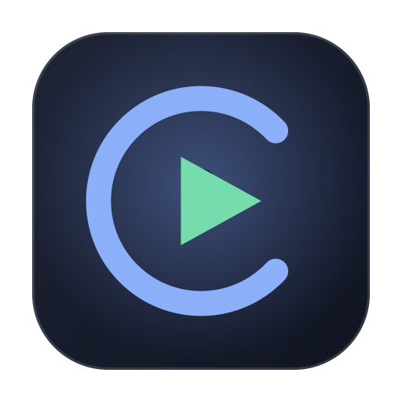
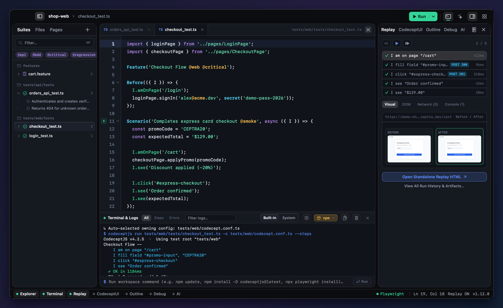

  
  <h1>Ceptra</h1>
  

    <strong>Native macOS IDE for CodeceptJS 4.x, Playwright (TS/JS &amp; Python), Mobilewright &amp; API Collections.</strong> 
    Built in SwiftUI &amp; AppKit — zero Electron overhead, zero third-party Swift dependencies.
  

  

    <a class="md-button md-button--primary" href="getting-started/quickstart/">5-Minute Quick Start</a>
    <a class="md-button" href="getting-started/installation/">Download &amp; Install</a>
    <a class="md-button" href="guides/api-client-studio/">Explore API Studio</a>
    <a class="md-button" href="https://github.com/kobenguyent/Ceptra/releases/latest">Latest GitHub Release</a>
  

  

    macOS 14+ Native Swift
    CodeceptJS 4.x
    Playwright TS / JS / Python
    Mobilewright iOS &amp; Android
    Postman · Insomnia · OpenAPI
    MIT License
  

{ .ceptra-shot }

---

## Everything in One Native macOS Workspace

  <a class="ceptra-card" href="guides/time-travel-replay/">
    <h3>Time-Travel Replay</h3>
    
Zero-config Web, API, Hybrid &amp; Mobile step replay with before/after screenshots, delta DOM snapshots, JSON tree, timing waterfall, and offline HTML export.

  </a>
  <a class="ceptra-card" href="guides/api-client-studio/">
    <h3>API Client Studio</h3>
    
Import, edit, chain, run, and export Postman v2.1, Insomnia v4, OpenAPI 3.x, HAR 1.2, <code>.http</code>, and cURL collections — without leaving Ceptra.

  </a>
  <a class="ceptra-card" href="frameworks/playwright/">
    <h3>Playwright TS/JS &amp; Python</h3>
    
First-class <code>@playwright/test</code> and <code>pytest-playwright</code> support with Codegen, embedded UI Mode, fixture IntelliSense, and full Replay telemetry.

  </a>
  <a class="ceptra-card" href="frameworks/mobilewright/">
    <h3>Mobilewright Device Studio</h3>
    
Guided 4-step device wizard, live iOS &amp; Android mirror, touch/swipe gestures, pixel-accurate view tree inspector, and ranked zero-XPath locators.

  </a>
  <a class="ceptra-card" href="guides/debugger/">
    <h3>CDP Step-Through Debugger</h3>
    
Gutter breakpoints, conditional breakpoints, logpoints, source-mapped TypeScript stepping, locals, watches, and CodeceptJS <code>pause()</code> shell.

  </a>
  <a class="ceptra-card" href="guides/ai-assistant/">
    <h3>AI Assistant &amp; SKILL.md</h3>
    
Local Ollama, Cloud APIs, or local CLI agents with 9 universal <code>/commands</code>, multimodal attachments, and 3-tier workspace security permissions.

  </a>
  <a class="ceptra-card" href="frameworks/codeceptjs/">
    <h3>CodeceptJS 4.x &amp; Monorepos</h3>
    
Automatic per-file <code>-c</code> config matching across Web/API monorepos, <code>run-workers</code>, <code>run-multiple</code>, embedded CodeceptUI, and Node.js / Bun switching.

  </a>
  <a class="ceptra-card" href="guides/editor-and-screenshots/">
    <h3>Editor Craft &amp; Screenshots</h3>
    
TextKit 1 editor, many-files tab context menu &amp; switcher, symbol navigation, smooth zoom, and 1-step 2×/3× Retina PNG code block screenshots.

  </a>

---

## Choose Your Path

| I want to… | Start here |
| --- | --- |
| Install Ceptra on macOS or build from source | [Installation &amp; Updates](getting-started/installation.md) |
| Scaffold a starter Playwright, Python, or CodeceptJS project | [5-Minute Quick Start](getting-started/quickstart.md) |
| Replace switching to Postman or Insomnia for API work | [API Client Studio Guide](guides/api-client-studio.md) |
| Inspect failing Web, API, or Python tests visually | [Time-Travel Replay Guide](guides/time-travel-replay.md) |
| Mirror &amp; inspect iOS Simulators or Android devices | [Mobilewright Device Studio](frameworks/mobilewright.md) |
| Configure a polyglot Web + API monorepo | [Monorepos &amp; Runtimes](MONOREPO-AND-RUNTIMES.md) |
| Look up a keyboard shortcut | [Keyboard Shortcuts Reference](SHORTCUTS.md) |
