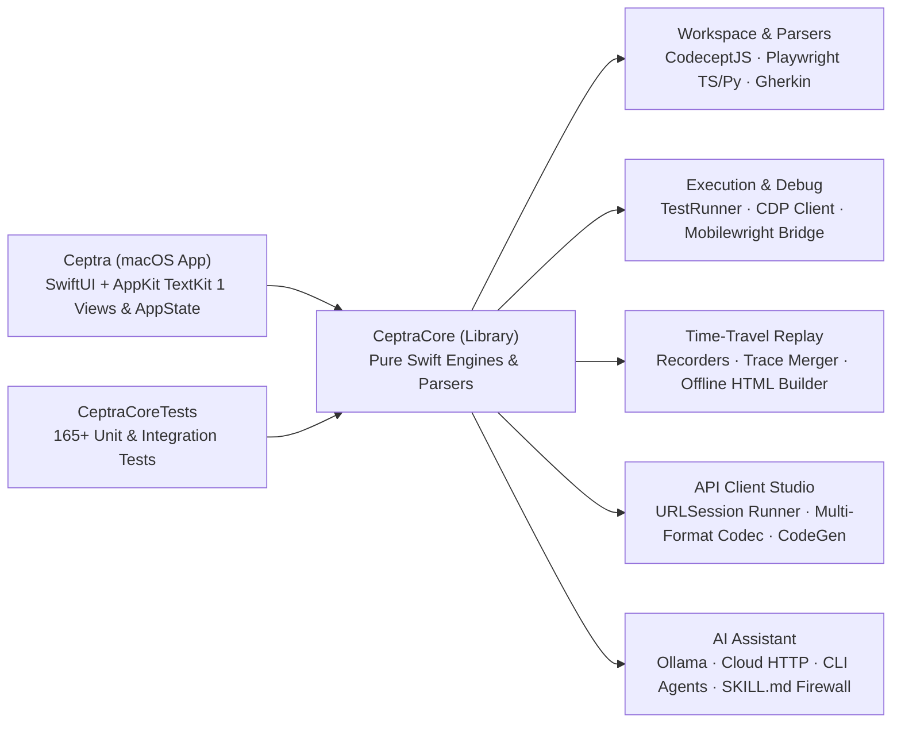

# Architecture & Security

Ceptra is designed around two core engineering principles: **zero-bloat native macOS performance** and **fail-closed local security**.

---

## Pure Swift Package Architecture

Ceptra compiles with SwiftPM (`Package.swift`) using **zero third-party Swift packages** — only Apple system frameworks (`Foundation`, `SwiftUI`, `AppKit`, `CryptoKit`, `Security`, `WebKit`):

- **`CeptraCore`**: Headless, fully unit-tested business logic (workspace discovery, polyglot config resolution, AST-free fast parsers, IntelliSense, code folding, tab reorder/batch-close geometry, CDP protocol client, Time-Travel Replay HTML generator, Mobilewright transport, AI provider router + secret redactor, and API Client Studio engine).
- **`Ceptra`**: Thin macOS SwiftUI + AppKit presentation shell (`MainStudioView`, `CodeEditorView`, `APIStudioView`, `ReplayInspectorView`, `MobilePhoneSidebarView`, `AIInspectorView`, `DebugInspectorView`).

---

## Security & Privacy Posture

| Surface | Safeguard |
| --- | --- |
| **API Keys &amp; Cloud Credentials** | Stored exclusively in **macOS Keychain** (`MacOSKeychainSecretStore`) — never persisted to settings JSON or conversation logs. |
| **AI Context &amp; Attachment Firewall** | Automatically blocks `.env` files, private keys, `~/.ssh`, `~/.aws`, and symlink escapes outside the workspace; scrubs bearer tokens, cookies, API keys, passwords, and DB URIs via `AISecretRedactor` before any cloud request. |
| **AI File Mutations** | 3-tier permission model (`Read` / `Ask` with diff preview / `Full`), jailed strictly to the active workspace root, with full undo support. |
| **Time-Travel Replay &amp; HTML Exports** | Redacts sensitive HTTP headers (`Authorization`, `Cookie`, `Set-Cookie`, `X-API-Key`, `X-Auth-Token`, `X-CSRF-Token`) automatically before writing traces or standalone HTML. |
| **API Client Studio Environments** | Separates shared `Initial Value` from local `Current Value`, supports secret masking in UI, and **redacts secret values on export by default**. |
| **Embedded Local Servers** | `@codeceptjs/ui` and Playwright UI servers bind strictly to loopback (`127.0.0.1`). |
| **In-App Updates** | Downloads exclusively from configured GitHub Releases and verifies `SHA256SUMS.txt` using Apple's `CryptoKit` before atomic app replacement. |
| **Zero Telemetry** | Ceptra makes no background analytics or tracking calls. |

---

## Automated CI/CD & Living Documentation

- **CI (`.github/workflows/ci.yml`)**: Runs `swift test --parallel`, release compilation, `.app` / `.dmg` / `.zip` packaging, and `SHA256SUMS.txt` checksum validation on `macos-15`.
- **Automatic Releases (`.github/workflows/release.yml`)**: Computes SemVer bumps via `scripts/next-version.sh`, packages universal (`arm64` + `x86_64`) archives, generates checksums, tags, and publishes GitHub Releases automatically on pushes to `main` (include `[skip release]` in a commit message to skip).
- **Living Documentation (`.github/workflows/docs.yml`)**: Strictly validates (`mkdocs build --strict`) all documentation on every pull request and deploys automatically to **GitHub Pages** (`https://kobenguyent.github.io/Ceptra/`) on every push to `main`.
